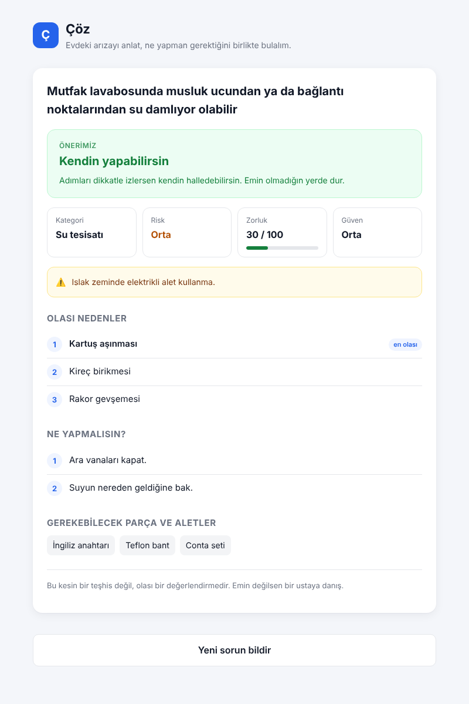

# Koz

Ev için yapay zekâ destekli bir asistan. Evde bir şey bozulduğunda da, eve bir iş yaptırmak istediğinde de (cam balkon, pencere, boya, parke gibi) kullanılır. İki bölümü var:

- **Bir sorun mu var?** Evdeki arızayı yaz ya da fotoğrafını çek. Koz olası nedenleri, riski ve zorluğu çıkarır; kendin mi yaparsın, usta mı gerekir, söyler. Tesisat, ev aletleri, nem ve küf sorunlarında tam analiz yapar; elektrik ve gazda güvenlik uyarısı verip profesyonele yönlendirir.
- **Yeni bir iş mi var?** Yaptıracağın işi yaz (boya ve badana, zemin, kapı ve pencere, dış cephe). Koz malzeme seçeneklerini, işin adımlarını, ustaya sorulacakları ve yaklaşık fiyatı çıkarır; böylece ustayla bilerek konuşursun.

Amaç ustanın yerini almak değil, doğru kararı vermeni sağlamak: arızada basit işi kendin yap, riskli işte vakit kaybetmeden profesyonele git; yeni bir işte ne istediğini ve ne kadar tutacağını bilerek ustayla konuş.



## Nasıl çalışır

### Bir sorun mu var? (arıza)

1. Kullanıcı sorunu yazar, isterse fotoğraf ekler (jpg/png/webp, en fazla 5 MB).
2. Model önce acil durum kontrolü yapar. Acilse normal akış durur, sadece güvenlik adımları verilir.
3. Bilgi yetmiyorsa en fazla bir tur, en fazla 3 soru sorar. Bilgi yetiyorsa soru sormaz, belirsizliği güven seviyesiyle belirtir.
4. Rapor döner: sorun, olası nedenler, güven, risk, zorluk puanı (0–100), parça ve aletler, adımlar, tahmini maliyet ve öneri.
5. Öneri zorluk puanına bağlıdır: 0–40 kendin yap, 41–60 usta önerilir, 61–100 usta gerekli.

Kapsam şimdilik su tesisatı, nem/küf ve beyaz eşya arızaları. Model fiyat yazmaz; tahmini maliyeti backend, `fiyatlar/malzeme_fiyatlari.json` dosyasındaki parça ve alet fiyatlarından hesaplar.

### Yeni bir iş mi var? (yeni iş)

1. Kullanıcı yaptırmak istediği işi yazar, isterse işin yapılacağı yerin fotoğrafını ekler.
2. Model işi türüne ayırır ve miktarı (m² veya adet) kullanıcının yazdığından çıkarır. Ölçü fotoğraftan tahmin edilmez; fotoğraf yüzeyin ve mevcut malzemenin durumunu okumak için kullanılır.
3. Miktar raporu ciddi biçimde değiştirecekse en fazla bir tur, en fazla 3 soru sorar; değilse varsayımını yazar.
4. Rapor döner: işin tanımı, malzeme seçenekleri, teknik detaylar, iş adımları, ustaya sorulacaklar, dikkat edilecek noktalar, süre, varsayımlar ve tahmini maliyet.

Model burada da fiyat yazmaz. Maliyeti backend, `fiyatlar/fiyatlar.json` tablosundan ve modelin çıkardığı miktardan hesaplar; işçilik ya da malzeme dahil fiyat ayrı tutulur. Tabloda olmayan işlerde bilgi verilir ama maliyet hesaplanmaz. Arıza anlatan girdiler arıza bölümüne yönlendirilir.

## Güvenlik kuralları

- Elektrik ve gaz için kendin-yap talimatı verilmez; sadece güvenlik uyarısı yapılır ve profesyonele yönlendirilir. Yeni iş bölümünde de bu işlerin yetkili kişilerce yapılması gerektiği yazılır.
- Emin olunamayan durum acil sayılır.
- Kendin yap önerisinde bile adımlarda nerede durup ustaya danışılacağı yazılır.
- Model cevabı şemaya göre doğrulanır; şemaya uymayan cevap kullanıcıya gösterilmez.

## Doğruluk ölçümü

Arıza bölümü 56 örneklik bir test seti (11'i fotoğraflı, 15'i acil) ile ölçüldü:

| Metrik | Sonuç |
|---|---|
| Öneri doğruluğu | 54/56 |
| Kategori doğruluğu | 55/56 |
| Gereksiz acil | 0/40 |
| Geçerli JSON | 56/56 |
| Kaçırılan acil | 1/15 |

En önemli metrik acil durumları kaçırmamak. Bu ölçümde kaçırılan tek acil durum, kombiden gelen kokunun önemsenmediği örnekti. Prompt'a gaz cihazı kokusu kuralı eklendi; bu örnek ve diğer 2 hatalı örnek yeniden denendi ve üçü de geçti.

Ölçüm `olcum.py` ile yapılır, sonuçlar `test/sonuclar/` klasörüne yazılır, `rapor.py` sonuçları tarayıcıda okunur bir sayfaya çevirir.

## Teknoloji

- Yapay zekâ: Claude API (görsel + metin)
- Backend: Python, FastAPI
- Veritabanı: MSSQL (yerelde SQL Server Express), `pyodbc`
- Arayüz: React, Vite
- Bulut (planlanan): AWS S3, RDS, EC2 veya App Runner

## Klasör yapısı

```
main.py        FastAPI backend (/analiz, /yeni-islem, giriş, profil, geçmiş)
deneme.py      Prompt'u API'ye gönderip sonucu ekrana yazan deneme betiği
olcum.py       Test setiyle doğruluk ölçümü
rapor.py       Ölçüm sonucunu HTML rapora çevirir
promptlar/     Sistem prompt'ları
fiyatlar/      Parça ve alet fiyatları
test/          Test seti, test fotoğrafları, ölçüm sonuçları
veritabani/    SQL tablo betikleri
frontend/      React arayüz
gorseller/     Ekran görüntüleri
arsiv/         Eski arayüz ve deneme dosyaları
```

## Kurulum ve çalıştırma

Gerekenler: Python 3.11+, Node.js, SQL Server (Express yeterli), ODBC Driver 17 for SQL Server, Claude API anahtarı.

1. Bağımlılıkları kur:

   ```bash
   pip install -r requirements.txt
   ```

2. `.env.example` dosyasını `.env` olarak kopyala, `ANTHROPIC_API_KEY` ve `DB_BAGLANTI` değerlerini doldur.
3. `veritabani/veritabani.sql` ve `veritabani/giris_tablolari.sql` betiklerini SQL Server'da çalıştır.
4. Arayüzü derle:

   ```bash
   cd frontend && npm install && npm run build
   ```

5. Sunucuyu başlat ve tarayıcıda `http://localhost:8000` adresini aç:

   ```bash
   uvicorn main:app --reload
   ```

## Geliştirme

Anthropic'in yapay zekâ asistanı Claude'un yardımıyla geliştirildi; prompt tasarımı, test betikleri ve kodlamada destek aldım. Ürün kararları, testler ve projenin yönü bana ait.
